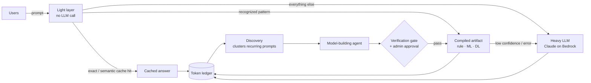
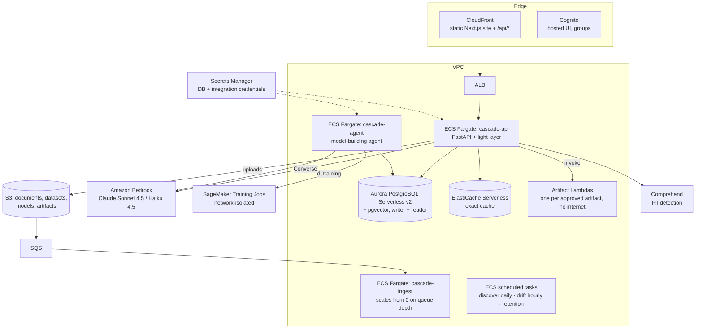

# Cascade

**Cascade turns recurring LLM traffic into deterministic code, and proves how much it saved.**

It sits between your users and an expensive LLM (Claude on Amazon Bedrock). Every prompt from every user is
monitored, logged and cached. When the same *kind* of request keeps coming back — "classify this ticket",
"convert 40 USD to EUR", "how many vacation days do I get in Germany?" — Cascade recognizes the pattern and an
agent compiles it into a deterministic artifact: plain Python rules, a classical ML model, or a small
deep-learning model, whichever is the cheapest one that passes verification. From then on that one artifact
answers matching prompts for every user, in milliseconds and for a fraction of a cent, while an admin keeps full
control over it (edit the code, retrain with more data, roll back, wire in an existing system).

Every token spent, avoided and saved is written to an auditable ledger, **net** of what it cost to build and
check the artifacts. The hard rule: **answer quality never drops below the LLM's.**

---

## Why this project exists

Most production LLM traffic is not creative work. Look at a week of logs from a support desk, an internal
assistant or an operations tool and the same few dozen request shapes make up a large share of the volume:
classify, route, extract a field, convert a unit, look up a policy value. Each of those calls:

- **costs tokens every time**, even though the answer is a function of the input that never changes;
- **is slow** — seconds for an LLM call, where a rule or a small model answers in a few milliseconds;
- **is probabilistic** — the same input can get a differently worded, or occasionally wrong, answer;
- **is opaque** — nobody can say how much of the LLM bill is this kind of repeat work, or what it would save to
  stop paying for it.

The usual fixes each cover one piece. A cache only helps with *identical* prompts. Hand-writing a classifier
for each request type needs an engineer per pattern and goes stale. Fine-tuning a smaller LLM is still an LLM.

Cascade closes the loop automatically: **observe → recognize → compile → verify → serve → measure**, with a human
approving each artifact before it serves traffic, and every number backed by the ledger. The LLM stays in the
loop for everything that genuinely needs it (open-ended answers, anything an artifact isn't confident about),
and it also acts as the teacher: artifacts are trained on, and continuously checked against, the LLM's own
answers.

---

## How it works



### 1. Every request: the router

Each prompt goes through a fixed order, and the first step that can answer safely does:

| Step | What happens | Cost |
|---|---|---|
| **Normalize** | The prompt becomes a template plus typed slots (`NUM`, `AMOUNT`, `DATE`, `ID`, `EMAIL`, `NAME`…), and is flagged if it is time-sensitive ("today", "latest") or a follow-up ("what about Germany?") | 0 tokens, in-process |
| **Exact cache** | `sha256(scope, fingerprint, normalized prompt)` | 0 tokens |
| **Semantic cache** | Local embedding model (`bge-small-en-v1.5`, ONNX on CPU); a hit needs cosine ≥ 0.95 **and** identical slot values, so "convert 5 USD" never returns the answer for "convert 50 USD" | 0 tokens |
| **Pattern recognizer** | Template match, then centroid + kNN / a trained classifier over embeddings | 0 tokens |
| **Artifact** | The approved artifact for that pattern runs **out of process** (a Lambda per artifact in AWS, an isolated worker locally) and returns `{result, confidence}` | ~ms, Lambda compute |
| **Heavy LLM** | Bedrock Converse with a budgeted context and cited sources | real tokens |

An artifact that errors, returns low confidence or says `__FALLBACK__` falls through to the LLM, so the user
never sees an artifact failure. Time-sensitive prompts and follow-ups skip the caches and artifacts entirely.

### 2. Recognizing patterns across all users

A scheduled discovery job (daily at 03:00 in AWS, or on demand by an admin) clusters the PII-redacted prompt log
across **all** users, uses a small model (Claude Haiku — never on the request path) to name each cluster and
detect its task type, and estimates what it would save: frequency × measured tokens per request × price. Only
**verifiable** task types are eligible — `classification`, `routing`, `extraction`, `transform`, `scoring` and
`lookup` (a fact from documents keyed by slot values). Open-ended generation is never compiled; repeated
free-form answers are served by the cache instead.

### 3. The model-building agent

When a pattern is recognized the admin sees it with example prompts, frequency, tokens per request, projected
savings and a suggested plan. Before anything is spent, the agent asks for optional instructions, extra
training/evaluation data, and any existing system the artifact must integrate with, and shows the budget cap.

After **Start**, the agent (a Bedrock Converse tool-use loop running as an ECS task, its state saved in Postgres
after every step) walks an escalation ladder:

1. **`rule`** — readable Python written by the LLM from a handful of examples;
2. **`ml`** — TF-IDF / embedding features + logistic regression or gradient boosting, exported to ONNX, once
   there are enough labelled samples;
3. **`dl`** — a small transformer fine-tuned as a SageMaker training job, exported to ONNX.

Labels come from the LLM's own answers on that pattern (distillation) plus any labelled data the user uploads,
which counts as ground truth. Each iteration ends with a report (agreement with the LLM on a holdout set,
per-class errors, latency, size, cost per request, projected net savings) and the user accepts, gives feedback,
adds data, or stops. Hard caps on iterations and dollars pause the run and ask.

### 4. Two locks before anything serves traffic

An artifact serves only after **both** a verification score above the threshold (1.0 for lookups) against the
LLM on held-out prompts **and** explicit admin approval, followed by a successful deploy. The agent can never
approve its own work. Any change sends the artifact back to draft and tears down its Lambda. After deployment,
an hourly drift job samples live traffic through both the artifact and the LLM and demotes artifacts that stop
agreeing.

### 5. Admin control after deployment

Each artifact has a control centre: version history (what produced each version, its status and verification),
diffs and one-click rollback, usage across users (served by the artifact vs. still on the LLM, tokens and cost
avoided per user), an editor for the rule code — and, for `ml`/`dl` artifacts, the exact readable `train()` and
`handle()` code, which can be edited and retrained in a sandboxed job that goes through the same holdout gate
and approval. Retrain with more data, rebuild with the agent, or attach an approved integration.

### 6. Knowledge (RAG), shared safely

Users attach knowledge collections (organization, team or private) to a conversation. Documents (PDF, DOCX,
HTML, Markdown, CSV) are parsed, chunked by heading, embedded into pgvector and retrieved with hybrid search
(vector + Postgres full text, fused with RRF, then reranked by a local cross-encoder). Access control is applied
**inside the SQL query**. A cached knowledge answer is reused only when the same chunks at the same versions
would be retrieved for that user today (a context fingerprint is part of every cache key), and artifacts built
from documents are re-verified automatically when those documents change.

### 7. The ledger: the product's core metric

Every request writes exactly one ledger entry: route, actual input/output tokens from Bedrock, how the input
splits (question / retrieved context / history / system), prompt-cache usage, actual cost, tokens and cost
**avoided**, and *how* "avoided" was estimated (`cache_exact`, `pattern_measured` or `heuristic` — estimates are
always labelled). Every overhead call — discovery, compile, verify, labelling, training, drift sampling,
ingestion — is recorded as overhead. The **Savings** dashboard reports baseline cost, gross and net savings,
savings rate, token reduction, input mix and per-pattern payback ("paid back after N requests"), per user,
per pattern, per collection and over time. Prices are configuration (`CASCADE_MODEL_PRICES`, or **Tools → Model
prices**), never code.

---

## Architecture

### On AWS



Everything is Terraform (`infra/terraform/`). Artifact Lambdas run in private subnets with no NAT gateway —
their only route is the S3 gateway endpoint for model downloads. An artifact may call an external system only
through an integration the admin approved, which gets exactly one egress rule to its target and credentials in
Secrets Manager; such artifacts are flagged "not fully deterministic" in the UI.

### Components

| Part | Technology | Where |
|---|---|---|
| API and router | Python 3.12, FastAPI, SQLAlchemy 2, Alembic | `backend/app/main.py`, `engine.py` |
| Light layer (System 1) | fastembed / ONNX `bge-small-en-v1.5`, scikit-learn | `backend/app/light/` |
| Heavy model (System 2) | Bedrock Converse (Demo LLM offline) | `backend/app/heavy.py` |
| Discovery, patterns, verification, drift | clustering + light LLM naming | `discovery.py`, `patterns.py`, `verifier.py`, `monitor.py` |
| Model-building agent | Converse tool use, no framework | `backend/app/agent/` |
| Compilers | rule codegen, scikit-learn → ONNX, transformer fine-tune → ONNX | `backend/app/compilers/` |
| Artifact runtime | Lambda (prod) / isolated subprocess (local) | `runtime.py`, `artifact_runner.py`, `deploy.py` |
| Ledger and savings | SQL aggregation, hourly rollups | `ledger.py`, `rollups.py`, `pricing.py` |
| Knowledge base | pgvector + full text, cross-encoder rerank | `backend/app/rag/` |
| Admin control centre | versions, diff, rollback, usage, retrain | `control.py` |
| Web workspace | Next.js (App Router), TypeScript, Tailwind, Monaco | `web/` |
| Infrastructure | Terraform on AWS | `infra/terraform/` |

Every backend switches by configuration, not code (`CASCADE_*` env vars): Demo LLM ↔ Bedrock, SQLite ↔ Postgres,
subprocess ↔ Lambda, local auth ↔ Cognito. The same code runs offline on a laptop and in AWS.

### Safety rules (enforced in code and covered by tests)

1. Only verifiable tasks are compiled.
2. Generated code and models never run inside the API process.
3. Two locks before serving: verification **and** human approval.
4. Fixed router order with safe fallback to the LLM.
5. Every request and every overhead call reaches the ledger; savings are reported net.
6. No cross-user leakage: per-user cache by default, a shared entry only for PII-free prompts, redaction before
   clustering/training, and a leak check that blocks user data from being baked into an artifact.
7. The agent asks before it spends and can never approve its own work.
8. Knowledge answers are never stale or unauthorized.

See [ARCHITECTURE.md](ARCHITECTURE.md) for the request path in detail and where each rule lives.

---

## Results

Measured on real Bedrock (eu-central-1, Claude Sonnet 4.5 heavy / Haiku 4.5 light), replaying 200 prompts of
the demo traffic (`make demo-measure`, 2026-10-19): routes **artifact 59 / cache 27 / LLM 114**, **28.3 % token
reduction**, total spend $0.13. On a sample that small the one-off cost of building the artifacts still exceeds
the savings (net −$0.015). Build overhead is paid once, while savings grow with every request, which is why the
dashboard shows per-pattern payback.

Performance (`make perf`): light-layer p95 ≈ 14 ms (SQLite) / 18 ms (Postgres) over 1,000 prompts, artifact route
p95 ≈ 14–26 ms, and a 60 s load test at ~48 requests/s with zero failures.

---

## Running it

### Quick start (no Docker, no AWS)

```bash
make setup        # backend (uv) + web (npm) deps, Playwright browser, local models, demo data
make api          # API on :8080 against SQLite, Demo LLM, local auth
cd web && NEXT_PUBLIC_API_BASE=http://localhost:8080 npm run dev     # UI on :3000
```
`python -m app.seed --reset` (from `backend/`) loads the demo starting state: a week of traffic from the fictional
Northpeak Outfitters, four knowledge collections, and approved artifacts.

### Full local stack

```bash
make dev          # docker compose: postgres (pgvector), api, agent-worker, ingest-worker, web, crm-mock
make demo-up      # start, migrate and seed;  make demo-reset  returns to the starting state
```
The `/demo` page and `demo/SCRIPT.md` walk through ten scenarios: live routing, safety rails, the savings
dashboard, knowledge answers, document changes, pattern → agent → trained model, lookups from documents, drift
protection, integrations, and real Bedrock numbers.

### Deploying to AWS

See [DEPLOY.md](DEPLOY.md): Bedrock model access, prices, `terraform apply`, `scripts/aws_deploy.sh` (builds amd64
images, pushes them, rolls the services, builds and uploads the web app), Cognito users, and
`scripts/aws_teardown.sh` to remove everything.

### Tests: the gate

`make verify` runs every suite except real-AWS tests — lint/types, backend unit (SQLite) and integration
(Postgres + pgvector), API contract, web unit, Playwright end-to-end including every demo scenario, evaluations
(retrieval recall, routing accuracy), performance and security — and writes `reports/summary.md`,
`reports/coverage/` and `reports/acceptance.md`. Real AWS is only touched by `make test-aws` and
`make demo-measure`, run by hand after deployment. Every other target blanks AWS credentials.

---

## Repository layout

```
backend/app/        FastAPI app: router (engine.py), light layer (light/), heavy model, ledger, discovery,
                    patterns, verifier, drift monitor, agent (agent/), compilers (compilers/), artifact runtime,
                    knowledge base (rag/), admin control centre
backend/alembic/    migrations (SQLite and PostgreSQL)
backend/tests/      unit, integration, contract, eval, perf, security, aws
web/                Next.js workspace: patterns explorer, artifact editor, agents, knowledge, savings, tools
demo/               the fictional demo world, documents, labelled evaluation sets, run-of-show, backup videos
infra/terraform/    AWS: VPC, Aurora + pgvector, ECS Fargate, ALB, CloudFront, Cognito, SQS, S3, Lambda, schedules
infra/runtime-images/  ml / dl Lambda runtimes and the SageMaker training image
scripts/            verify, deploy, teardown, acceptance matrix
```

**Further reading:** [BUILD.md](BUILD.md) is the full specification · [ARCHITECTURE.md](ARCHITECTURE.md) the request
path and correctness rules · [DEPLOY.md](DEPLOY.md) deployment · [PROGRESS.md](PROGRESS.md) build status and
evidence · [docs/decisions.md](docs/decisions.md) the choices taken where the spec left room.
